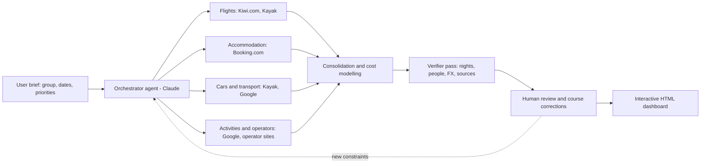

# Lapland 2027 Trip Planner: an agentic AI research and decision-support case study

An LLM agent (Claude) orchestrated research sub-agents connected to travel-data connectors (Booking.com, Kayak, Kiwi.com, Google) and consolidated their findings into an interactive dashboard for a multi-criteria group-travel decision.

**Live demo:** https://alejandrovinuesa.github.io/voyageplanner_lapland_2027/
(The dashboard interface is in Spanish, as it was built for a Spanish-speaking group.)

## The problem

A group of 10-14 people wanted to travel from Copenhagen to Lapland in late January 2027, with northern lights as the top priority. Three candidate itineraries had to be compared on the same basis:

| Option | Nights | Idea |
|---|---|---|
| Kiruna + Norway | 4 or 5 | Road trip by car: Kiruna, Narvik, Abisko |
| Rovaniemi | 4 (fixed) | Flight to Helsinki, night train, house with cars |
| Tromso only | 4 or 5 | Direct flight, one base, cars every day |

Each option involves several interacting decisions, so a simple price lookup is not enough:

- **Cost per person**, depending on group size (10-14) and number of nights (4 or 5)
- **Flights** (carry-on only, several departure and return times per option)
- **Accommodation** priced for each group size
- **Ground transport alternatives** (car classes, vans, night train, ferries, tolls, fuel or charging, insurance, young-driver fees)
- **Time and transfers**, including daylight hours (roughly 4-6 hours of sun in late January) that constrain which activities fit on which day
- **Optional activities** (huskies, snowmobiles, reindeer, sauna, etc.) that change both total cost and the daily schedule

## How agentic AI was used

An orchestrating agent (Claude) took the group's brief and delegated data gathering to research sub-agents/tools connected to travel-data sources through MCP-style tool calls. Each gathered options for its part of the problem (flights, accommodation, cars/transport, activities). The orchestrator then consolidated the results into one cost model and generated the HTML dashboard.



What the generated dashboard does with the consolidated data:

- Compares the three options side by side, with a per-person total that updates live.
- Lets the user change group size, nights, flight, accommodation, transport mode and activities.
- Shows transport alternatives per option and a summary table by group size, flagging the cheapest option.
- Builds a day-by-day plan that respects daylight windows.
- Documents its own assumptions: each price is labelled as a **source** or an **estimate**, exchange rates are stated (SEK, NOK, DKK to EUR), and a +5 % contingency buffer is applied. Source links are listed on the page.

### How the work was orchestrated

The project ran on three levels: a **human** (me) set the goal, constraints and criteria and validated every result; an **orchestrator agent** broke each request into tasks, integrated the results and checked consistency; and **sub-agents** ran narrow tasks in parallel (flights, accommodation, cars, activities, number checks). A final verifier pass looked for inconsistencies in nights, people, currencies and unsourced prices.

The tool was built over **six iteration rounds**, each triggered by a human correction the AI would not have made on its own:

| Round | Human correction | Effect |
|---|---|---|
| 1 | "Cheap, but with guaranteed quality" | Accommodation filtered by rating, not price alone |
| 2 | Fixed dates; "overestimate rather than underestimate" | +5 % buffer; every line labelled *source* or *estimate* |
| 3 | Group of 20 → 10–14; Kiruna route extended to Norway | Cost model became a 10–14 person selector |
| 4 | Carry-on only; SUVs instead of vans | Flights and car fleet re-searched under real constraints |
| 5 | Third option replaced by "Tromsø only" | Final comparison between three plans the group considers viable |
| 6 | Publish and document | README and process documentation |

**Full process, iteration log and reusable prompt templates (orchestrator, sub-agent, verifier):** [docs/PROCESS.md](docs/PROCESS.md) · [versión en español](docs/PROCESS.es.md)

## Human in the loop and limitations

- Prices are **snapshots**: flights, accommodation and cars were checked on 9-10 November 2026 (cars partly on 7 November). Availability and prices will change.
- Agent outputs were **reviewed manually** and adjusted with the group's own planning; some figures are deliberate overestimates, and group sizes above 9 may need split bookings.
- Activity prices are "from" prices taken from operator websites or are estimates, and are labelled as such.
- This is a **planning and comparison tool, not a booking engine or an offer**. Confirm prices, schedules and conditions before paying.

## Skills demonstrated

- Agent orchestration: delegating subtasks to research agents and merging their outputs
- Tool use and connectors (Booking.com, Kayak, Kiwi.com, Google) via MCP-style tool calls
- Multi-criteria comparison under constraints (budget, time, transfers, daylight, group size)
- Data consolidation and transparent cost modelling (sources vs estimates, FX rates, contingency)
- Front-end reporting: an interactive HTML/CSS/JS dashboard
- Critical review of AI outputs and clear communication of uncertainty

## Tech

- LLM agents (Claude) with travel-data connectors
- HTML, CSS and vanilla JavaScript in a single file, hosted on GitHub Pages

## Repository structure

```
index.html             the whole dashboard (HTML + CSS + JS in a single file)
docs/PROCESS.md        how it was built: prompts, iteration and human oversight
docs/PROCESS.es.md     Spanish version of the process document
README.md
```
