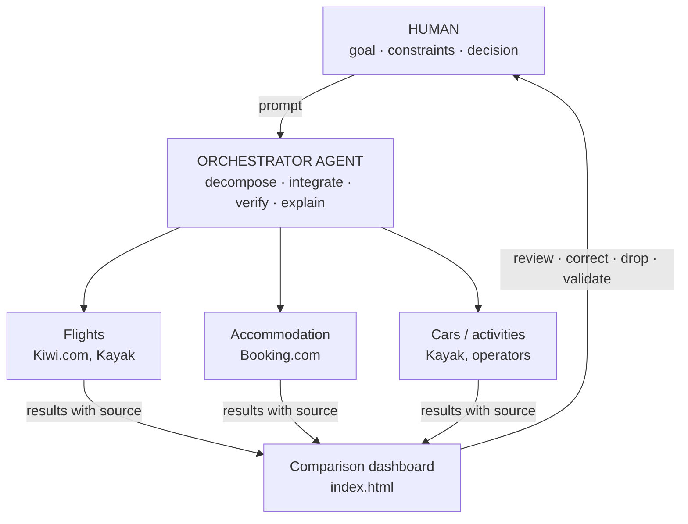

# How it was built: prompts, iteration and human oversight

This document explains the process behind the **Lapland 2027** comparison tool: agentic AI working under human direction, with an orchestrator agent that splits the work across sub-agents and a human who decides, corrects and validates. It complements the [main README](../README.md). [Versión en español](PROCESS.es.md).

> **Core idea:** the AI did not choose the trip. It sped up searching, calculating and comparing; every decision that changed the final result was taken by a person.

---

## 1. Three levels of work

| Level | Who | What it does | What it does NOT do |
|---|---|---|---|
| **Direction** | Human (Alejandro) | Sets the goal, constraints and criteria; drops or adds options; validates every result. | Does not look up prices by hand or do the arithmetic. |
| **Orchestration** | Main agent | Breaks each request into tasks, dispatches them, integrates the results, checks consistency and explains them. | Never accepts a figure without a source; never books or pays. |
| **Execution** | Sub-agents | Narrow, parallel tasks: flights, accommodation, cars, activities, number checks. | Do not make scope decisions or change the approach. |



---

## 2. Iteration timeline

Every round started with a human correction and ended with a better result than the one before.

| Round | Human input | Agent work | Improvement |
|---|---|---|---|
| **0 · Starting point** | Takes a friend's trip planner and asks to extend it so destinations can be compared. | — | A single route, no alternatives yet. |
| **1 · Cheap, but with quality** | Prioritises cheap accommodation *with guaranteed quality* and asks for alternatives, including Rovaniemi (Finnish Lapland). | Searches accommodation filtered by rating and compares several options. | The quality criterion prevents choosing on price alone. |
| **2 · Focus and safety margin** | Narrows to **Kiruna vs Rovaniemi**, fixes the dates (25–31 January, 4–5 nights) and asks to **overestimate rather than underestimate**. | Adds a buffer to the cost model and labels every line as *source* or *estimate*. | Totals stop being optimistic and every figure is auditable. |
| **3 · The group changes** | Corrects group size (from 20 to **10–14 people**) and turns the Kiruna route into **Kiruna + Norway** (Narvik, Abisko). | Recalculates accommodation by group size, cars needed and cost per person. | The model becomes a **10–14 person selector**, not a fixed number. |
| **4 · Three options and flight constraints** | Compares three options, asks for **carry-on only** flights and **family cars/SUVs** instead of vans. | Re-runs the flight search with that condition and reviews cars (insurance, young driver, extra driver, fuel, tolls and ferries). | Realistic prices for the trip that will actually happen. |
| **5 · Replacing the third option** | Replaces *Full Norway* with **Tromsø only** (a friend's plan, with a car every day). | Rebuilds that option end to end: direct flight, house on Kvaløya, Lyngen, Sommarøy. | The final comparison is between three plans the group considers viable. |
| **6 · Publishing and documentation** | Asks to update and publish the repository README and document the process. | Rewrites the README and checks the rendered result. | The repository explains what is there, how it was calculated and what is an estimate. |

---

## 3. What the human corrected (that the AI would not have caught alone)

| Human intervention | Why it mattered | Effect on the output |
|---|---|---|
| "Cheap but with quality" | AI tends to minimise price. | Rating filter on accommodation. |
| "Overestimate rather than underestimate" | An optimistic budget breaks a group trip. | +5 % buffer, conservative line items. |
| Group of 20 → 10–14 | Changes cars, houses and price per person. | Recalculation by group size. |
| Carry-on only | A personal detail that changes the flight price. | Flights searched without checked luggage. |
| SUVs instead of vans | Practical knowledge of snow and roads. | Car fleet revised. |
| Replacing the third option | Information only the group had. | A more useful comparison. |
| Getting time off work for the dates | A real constraint outside the AI's reach. | A realistic date window. |

---

## 4. What orchestration with sub-agents added

- **Parallelism:** flights, accommodation, cars and activities are researched at the same time, not one after another.
- **Scoped context:** each sub-agent receives only what it needs (dates, group, constraints): less noise, fewer errors.
- **Integration with judgement:** the orchestrator unifies currencies (10.95 SEK/€, 11.5 NOK/€, 7.46 DKK/€), formats and assumptions before showing anything.
- **Cross-checking:** a final pass looks for inconsistencies (nights, people, currencies, prices without a source).
- **Traceability:** every line item states whether it is a **source** or an **estimate**, so the human knows what to trust.

---

## 5. Reusable prompt templates

Generalised templates of the method; not literal transcripts.

**Orchestrator: kickoff**
```
Goal: compare [N] travel options for [group, dates, origin].
Priority: [what matters]. Constraints: [carry-on only, car type, budget...].
Break this into independent tasks, launch sub-agents in parallel,
and return a comparison table with "source" or "estimate" on every line.
Overestimate rather than underestimate. Do not book or pay for anything.
```

**Sub-agent: scoped task**
```
Task: find [flights | accommodation | car] for [dates, people].
Constraints: [...]. Return: ranked options, total and per-person price,
link or source, and date checked. Label anything unconfirmed as "estimate".
```

**Verifier: final review**
```
Review the result like an auditor: do nights and people match across all lines?
Are there prices without a source? Are currencies mixed? Does any assumption
contradict the constraints? List the problems; do not fix them silently.
```

**Human: course correction**
```
Change [X] to [Y] because [reason]. Recalculate only what is affected
and tell me which totals move.
```

---

## 6. Limits and good practice

- Prices were checked on **9–10 November 2026** and may change at booking time.
- This is a planning tool: it **does not book or pay**. A person decides and does that.
- A figure labelled as an estimate is a hypothesis, not data; confirm it before committing money.
- When the AI and the human disagree, human judgement wins; the AI must explain the impact of the change.

---

## 7. What this project demonstrates

1. **More iterations, better result:** each human correction improved the model (group, quality, luggage, cars, options).
2. **Effective oversight:** scope and risk decisions were never delegated.
3. **Clear division of labour:** a person directs, an orchestrator coordinates, sub-agents execute in parallel.
4. **Auditable output:** every figure says where it comes from and how much margin it carries.

---

*Process document. Not a booking or an offer.*
